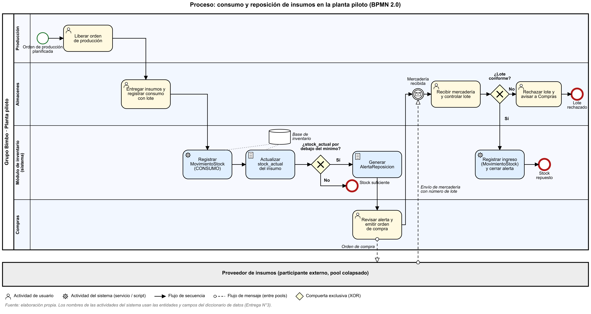

# Proceso de negocio: consumo y reposición de insumos (BPMN 2.0)



## Qué proceso se modela y por qué

Es el proceso que el módulo de inventario automatiza o transforma: desde que Producción libera una orden y Almacenes entrega los insumos, hasta que el stock vuelve a reponerse con la compra al proveedor. Hoy ese recorrido depende de que alguien note a tiempo que falta un insumo; con el módulo, la detección del faltante y la alerta las hace el sistema.

## Participantes

| Elemento BPMN | Participante | Por qué |
|---|---|---|
| **Pool** "Grupo Bimbo · Planta piloto" | La organización | Contiene un único proceso (regla del apunte de la Unidad 5). |
| Lane **Producción** | Supervisor de Producción | Usuario clave del comité (staff del organigrama). |
| Lane **Almacenes** | Encargado de Almacenes | Usuario clave del comité. |
| Lane **Módulo de inventario (sistema)** | El software | Representa el comportamiento automatizado: actividades de tipo *servicio* y *script*. |
| Lane **Compras** | Responsable de Compras | Usuario clave del comité. |
| **Pool colapsado** "Proveedor de insumos" | Actor externo | Se comunica solo mediante flujos de mensaje (orden de compra y envío de la mercadería). |

> **Decisión de modelado:** los roles del equipo de desarrollo (analista, desarrolladores, tester) **no** son lanes de este proceso, porque construyen el sistema pero no participan de la operación diaria de la planta. Los lanes son las áreas usuarias del **Comité de usuarios clave** y el propio sistema, que es quien hace el trabajo automatizado.

## Flujo estándar

1. **Inicio:** orden de producción planificada.
2. Producción **libera la orden** (HU-03: el estado pasa a `EN_PRODUCCION`).
3. Almacenes **entrega los insumos y registra el consumo con el lote** (HU-01).
4. El sistema **registra el `MovimientoStock` de tipo `CONSUMO`** y **actualiza `stock_actual`** del insumo (ambos usan el *data store* "Base de inventario").
5. **Compuerta exclusiva "¿stock_actual por debajo del mínimo?"**
   - **No** → fin "Stock suficiente".
   - **Sí** → el sistema **genera la `AlertaReposicion`** (HU-02).
6. Compras **revisa la alerta y emite la orden de compra** → flujo de mensaje al proveedor.
7. **Evento intermedio de mensaje** "Mercadería recibida" (el proceso espera la entrega).
8. Almacenes **recibe la mercadería y controla el lote**.
9. **Compuerta exclusiva "¿Lote conforme?"**
   - **Sí** → el sistema **registra el ingreso (`MovimientoStock` de tipo `INGRESO`) y cierra la alerta** → fin "Stock repuesto".
   - **No** → Almacenes **rechaza el lote y avisa a Compras** → fin "Lote rechazado" (excepción).

## Secuencia temporal entre las entidades

Responde a la observación de la Entrega N°3: la `AlertaReposicion` no se crea sola, sino como consecuencia de una cadena de eventos.

```
MovimientoStock (CONSUMO) ──actualiza──▶ Insumo.stock_actual ──si queda < stock_minimo──▶ AlertaReposicion (atendida = falso)
MovimientoStock (INGRESO) ──actualiza──▶ Insumo.stock_actual ──si supera stock_minimo──▶ AlertaReposicion (atendida = verdadero)
```

## Convenciones aplicadas (apunte de la Unidad 5)

- Modelado de izquierda a derecha y de arriba hacia abajo.
- Actividades con verbo en infinitivo; íconos de **usuario** (personas con ayuda del sistema) y de **servicio** o **script** (lo que hace el sistema sin intervención humana).
- Compuertas exclusivas identificadas con una **pregunta** y con todas sus salidas **etiquetadas**; cada decisión tiene una actividad previa que la evalúa.
- Varios eventos de fin, para distinguir cómo termina el proceso (stock suficiente, repuesto o lote rechazado).
- Los flujos de secuencia no cruzan pools; la comunicación con el proveedor se hace con **flujos de mensaje**.
